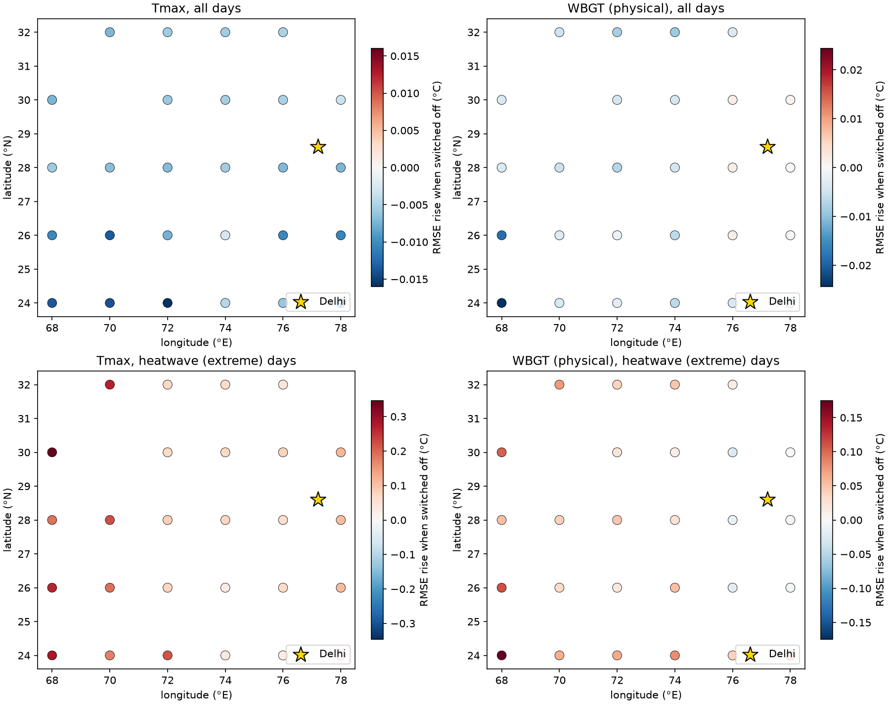

# What the graph learned: occlusion on C3-hop (specified 2026-10-18, before it was computed)

Each input is replaced by its training mean on the validation windows (2007-2018, 10 seeds x 4 folds); the table gives the rise in RMSE (°C; mean over seeds and folds, SD in brackets). Larger = the forecast leans on it more. Descriptive only.

## Tmax

| Switched off | Δ RMSE all days | Δ RMSE extreme days |
|---|---|---|
| Delhi inputs | +1.202 (0.520) | +4.040 (0.767) |
| hop 4 (all days) | +0.243 (0.120) | +1.334 (0.254) |
| hop 3 (all days) | +0.189 (0.152) | +1.355 (0.382) |
| hop 1 (all days) | +0.166 (0.107) | +1.089 (0.502) |
| hop 2 (all days) | +0.114 (0.090) | +0.878 (0.332) |
| n26e074 all days | -0.003 (0.006) | +0.028 (0.048) |
| n30e078 all days | -0.003 (0.011) | +0.114 (0.050) |
| n24e074 all days | -0.005 (0.006) | +0.036 (0.045) |
| n32e076 all days | -0.005 (0.008) | +0.044 (0.051) |
| n30e076 all days | -0.005 (0.010) | +0.080 (0.069) |
| n30e074 all days | -0.005 (0.010) | +0.072 (0.060) |
| n32e074 all days | -0.006 (0.011) | +0.066 (0.039) |
| n28e074 all days | -0.006 (0.012) | +0.075 (0.062) |
| n32e072 all days | -0.006 (0.012) | +0.072 (0.030) |
| n28e068 all days | -0.006 (0.031) | +0.187 (0.053) |
| n30e072 all days | -0.006 (0.010) | +0.069 (0.027) |
| n24e076 all days | -0.006 (0.006) | +0.027 (0.061) |
| n28e070 all days | -0.007 (0.030) | +0.222 (0.075) |
| n28e072 all days | -0.007 (0.010) | +0.082 (0.035) |
| n28e076 all days | -0.007 (0.010) | +0.060 (0.073) |
| n32e070 all days | -0.007 (0.035) | +0.267 (0.087) |
| n28e078 all days | -0.007 (0.011) | +0.109 (0.057) |
| n30e068 all days | -0.007 (0.032) | +0.346 (0.088) |
| n26e072 all days | -0.008 (0.010) | +0.074 (0.042) |
| n24e078 all days | -0.009 (0.008) | +0.067 (0.043) |
| n26e068 all days | -0.010 (0.034) | +0.263 (0.061) |
| n26e076 all days | -0.011 (0.010) | +0.065 (0.079) |
| n26e078 all days | -0.011 (0.011) | +0.108 (0.065) |
| n26e070 all days | -0.013 (0.024) | +0.190 (0.075) |
| n24e068 all days | -0.014 (0.026) | +0.283 (0.079) |
| n24e070 all days | -0.014 (0.021) | +0.175 (0.073) |
| n24e072 all days | -0.016 (0.021) | +0.217 (0.076) |

Top 8 points, last input day only: n30e078 -0.004; n26e074 -0.005; n30e072 -0.005; n32e072 -0.005; n32e076 -0.005; n26e072 -0.005; n28e072 -0.005; n24e074 -0.006

## WBGT (physical)

| Switched off | Δ RMSE all days | Δ RMSE extreme days |
|---|---|---|
| hop 1 (all days) | +0.045 (0.040) | +0.018 (0.164) |
| hop 3 (all days) | +0.022 (0.054) | +0.330 (0.213) |
| hop 2 (all days) | +0.009 (0.055) | +0.484 (0.283) |
| n28e076 all days | +0.002 (0.007) | -0.013 (0.036) |
| n30e076 all days | +0.002 (0.007) | -0.025 (0.042) |
| n26e076 all days | +0.002 (0.005) | -0.019 (0.043) |
| n30e078 all days | +0.001 (0.005) | -0.003 (0.031) |
| n26e078 all days | +0.000 (0.004) | -0.005 (0.032) |
| n28e078 all days | -0.000 (0.005) | +0.002 (0.031) |
| n26e072 all days | -0.001 (0.011) | +0.017 (0.059) |
| Delhi inputs | -0.002 (0.038) | +0.516 (0.144) |
| n24e072 all days | -0.003 (0.012) | +0.065 (0.043) |
| n26e070 all days | -0.003 (0.011) | +0.033 (0.048) |
| n32e076 all days | -0.004 (0.005) | +0.013 (0.025) |
| n28e068 all days | -0.004 (0.014) | +0.052 (0.080) |
| n24e076 all days | -0.004 (0.005) | +0.040 (0.030) |
| n24e070 all days | -0.004 (0.012) | +0.064 (0.056) |
| n30e068 all days | -0.004 (0.014) | +0.105 (0.082) |
| n30e074 all days | -0.004 (0.005) | +0.013 (0.026) |
| n30e072 all days | -0.004 (0.005) | +0.024 (0.030) |
| n28e074 all days | -0.005 (0.005) | +0.023 (0.029) |
| n32e070 all days | -0.005 (0.009) | +0.074 (0.055) |
| n28e070 all days | -0.005 (0.008) | +0.042 (0.038) |
| n24e078 all days | -0.006 (0.005) | +0.044 (0.024) |
| n24e074 all days | -0.007 (0.006) | +0.081 (0.053) |
| n26e074 all days | -0.007 (0.005) | +0.052 (0.027) |
| n28e072 all days | -0.007 (0.005) | +0.047 (0.027) |
| n32e072 all days | -0.008 (0.007) | +0.040 (0.036) |
| n32e074 all days | -0.009 (0.007) | +0.048 (0.044) |
| hop 4 (all days) | -0.011 (0.047) | +0.510 (0.282) |
| n26e068 all days | -0.019 (0.012) | +0.113 (0.072) |
| n24e068 all days | -0.024 (0.012) | +0.174 (0.098) |

Top 8 points, last input day only: n30e068 +0.003; n26e076 -0.003; n30e078 -0.003; n26e078 -0.003; n28e074 -0.004; n24e072 -0.004; n32e070 -0.004; n28e070 -0.004

